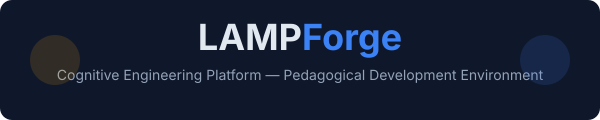
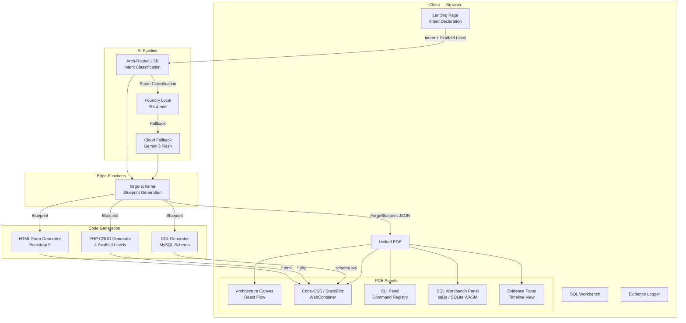
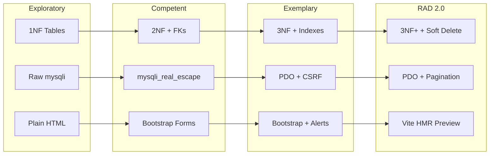
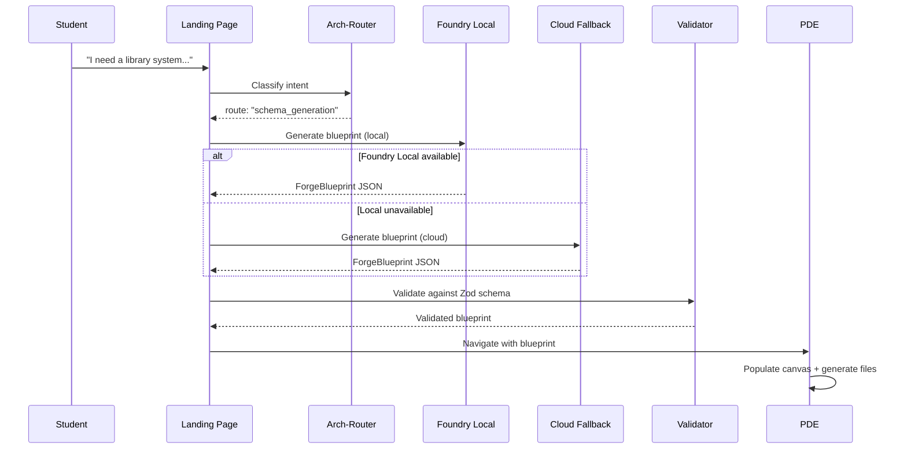
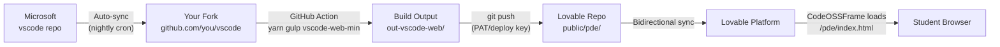

<p align="center">
  
</p>

<h1 align="center">🔥 LAMPForge — Cognitive Engineering Platform</h1>

<p align="center">
  <strong>AI-powered scaffolding · Live code generation · In-browser execution</strong>
  <br />
  <em>Eliminating infrastructure friction for A-Level Digital Technology students</em>
</p>

<p align="center">
  <a href="https://pedagogical-development-environment-sdtp.lovable.app">Live Demo</a> ·
  <a href="docs/ARCHITECTURE.md">Architecture</a> ·
  <a href="docs/USER-JOURNEYS.md">User Journeys</a> ·
  <a href="docs/RATIONALE.md">Design Rationale</a> ·
  <a href="docs/CI-CD-PIPELINE.md">CI/CD Pipeline</a>
</p>

---

## Table of Contents

- [What is LAMPForge?](#what-is-lampforge)
- [The Problem](#the-problem)
- [The Solution](#the-solution)
- [Platform Screenshots](#platform-screenshots)
- [System Architecture](#system-architecture)
- [The 5-Family Taxonomy](#the-5-family-taxonomy)
- [Scaffold Levels](#scaffold-levels)
- [AI Pipeline](#ai-pipeline)
- [Technology Stack](#technology-stack)
- [Project Structure](#project-structure)
- [Getting Started](#getting-started)
- [Sovereign CI/CD Pipeline](#sovereign-cicd-pipeline)
- [Documentation Index](#documentation-index)
- [License](#license)

---

## What is LAMPForge?

LAMPForge is a **Pedagogical Development Environment (PDE)** — a cognitive engineering platform that transforms how A-Level Digital Technology students learn database-driven web development. Instead of spending hours wrestling with XAMPP, phpMyAdmin, and configuration files, students **declare their intent in plain English** and LAMPForge translates it into:

- ✅ Normalised database schemas (1NF → 3NF+)
- ✅ PHP CRUD operations (from `mysqli` to PDO with CSRF protection)
- ✅ Bootstrap-powered HTML forms
- ✅ Live-editable code in a VS Code-style IDE
- ✅ An in-browser SQL workbench with real SQLite execution
- ✅ Automatic SDLC evidence logging for coursework portfolios

---

## The Problem

> *"Students spend 70% of their coursework time on infrastructure setup and only 30% on actual learning."*

The WJEC/Eduqas Digital Technology Unit 4 requires students to build a LAMP-stack web application demonstrating the full Software Development Life Cycle (SDLC). The current landscape presents critical barriers:

| Barrier | Impact |
|---------|--------|
| **XAMPP/WAMP configuration** | Hours lost to `localhost` issues, port conflicts, PHP version mismatches |
| **SQL syntax errors** | Students abandon complex schemas, defaulting to flat 1NF tables |
| **PHP security patterns** | SQL injection, XSS, CSRF — concepts too advanced for the time allotted |
| **Evidence collection** | Manual screenshots, copy-paste of SQL — tedious and error-prone |
| **Grade ceiling** | Without scaffolding, most students plateau at Grade C |

---

## The Solution

LAMPForge inverts the paradigm: **Intent → Architecture → Code → Evidence**

```
┌─────────────────┐     ┌──────────────────┐     ┌──────────────────┐     ┌──────────────────┐
│  Student types   │────▶│  AI generates    │────▶│  Code appears    │────▶│  Evidence logged  │
│  plain English   │     │  blueprint       │     │  in IDE          │     │  automatically    │
│  intent          │     │  (entities,      │     │  (SQL + PHP +    │     │  (SDLC timeline)  │
│                  │     │   relationships, │     │   HTML forms)    │     │                   │
│                  │     │   CRUD ops)      │     │                  │     │                   │
└─────────────────┘     └──────────────────┘     └──────────────────┘     └──────────────────┘
```

---

## Platform Screenshots

### Landing Page — Intent Declaration

The landing page is the entry point. Students describe what they want to build in natural language, select their target scaffold level, and hit "Forge It."


*The hero section with scaffold level selector (Exploratory → RAD 2.0), intent textarea, and template gallery.*

### Unified PDE — Development Environment

The PDE provides a full IDE experience with architecture canvas, code editor, CLI, SQL workbench, and evidence panel — all in one view.


*The unified PDE showing the architecture canvas (left), Code-OSS editor (right), CLI with ASCII banner (bottom), and panel toggle bar (top).*

### Architecture Canvas

A visual React Flow canvas where entities and relationships are rendered as interactive nodes. Students can add entities, connect them with relationships, and see the schema evolve in real-time.


*The canvas with Entity and Transaction nodes, StackBlitz WebContainer editor, and the LAMPForge CLI terminal.*

### SQL Workbench

A fully functional SQL workbench powered by `sql.js` (SQLite compiled to WebAssembly). Students can execute queries against their generated schema without any server-side infrastructure.


*Schema explorer sidebar, Monaco-powered query editor, and tabular results grid.*

### Evidence & SDLC Logger

Automatic evidence capture across the full SDLC. Every action — schema generation, query execution, code editing — is timestamped and categorised by stage.


*Timeline view with SDLC stage badges (Analysis, Design, Implementation, Testing, Evaluation) and event cards.*

---

## System Architecture



### Key Architectural Decisions

| Decision | Rationale |
|----------|-----------|
| **In-browser SQLite via WASM** | Zero infrastructure — no MySQL server needed |
| **StackBlitz WebContainer** | Full Node.js runtime in browser — no backend hosting |
| **Code-OSS iframe** | Sovereign VS Code build via CI/CD pipeline |
| **BroadcastChannel API** | Panel undocking to separate browser tabs |
| **Zod schema validation** | Type-safe blueprint validation at runtime |
| **Tiered AI fallback** | Local-first (Foundry Local) → Cloud fallback |

---

## The 5-Family Taxonomy

LAMPForge organises all concepts into five cognitive families, each with a colour-coded identity:

| Family | Colour | Icon | Purpose |
|--------|--------|------|---------|
| **Blueprint** | 🔵 Blue | `#3B82F6` | Entity design, schema, ERD, normalisation |
| **Plumbing** | 🟢 Green | `#22C55E` | Connectivity — relationships, FKs, joins, state |
| **Transaction** | 🟠 Orange | `#F59E0B` | Logic — CRUD operations, sessions, validation |
| **Forge** | 🔴 Red | `#EF4444` | Provisioning — code generation, build, deploy |
| **Oracle** | 🟣 Purple | `#A855F7` | AI inference, analysis, suggestions, feedback |

This taxonomy maps directly to the visual language of the canvas nodes, CLI output coloring, and evidence log badges.

---

## Scaffold Levels

LAMPForge adapts its output to four scaffold levels, each targeting a different WJEC grade band:

| Level | Grade Target | Normalisation | PHP Style | Security | Features |
|-------|-------------|---------------|-----------|----------|----------|
| **Exploratory** | E/D | 1NF (flat) | Raw `mysqli` | None | Basic forms, no FK |
| **Competent** | C/B | 2NF | `mysqli` + escaping | Input sanitisation | Bootstrap, FK constraints |
| **Exemplary** | A/A* | 3NF | PDO prepared statements | CSRF tokens, sessions | Indexes, audit columns, junction tables |
| **RAD 2.0** | No ceiling | 3NF+ | PDO + soft deletes | Full security stack | Pagination, search, HMR preview |

### How Scaffold Levels Affect Code Generation



---

## AI Pipeline

The AI pipeline uses a three-stage architecture with local-first inference:

### Stage 1: Arch-Router (Intent Classification)

An optional lightweight model (`arch-router-1.5b`) classifies user intent into route policies:
- `schema_generation` — Complex multi-entity schemas
- `simple_crud` — Single-entity CRUD apps
- `ecommerce` — Transactional systems with carts/orders

### Stage 2: Blueprint Generation

Two strategies, tried in order:

1. **Foundry Local** (offline-capable): Phi-4-mini via `localhost:5273` with OpenAI-compatible tool-calling
2. **Cloud Fallback**: Gemini 3 Flash via Lovable AI gateway edge function

### Stage 3: Validation

The generated blueprint is validated against the `ForgeBlueprintSchema` (Zod) with cross-reference checks:
- All relationship endpoints reference existing entities
- All transaction entities exist
- All page routes reference valid entities



---

## Technology Stack

### Frontend
| Technology | Purpose |
|-----------|---------|
| **React 18** | Component framework |
| **Vite** | Build tool with HMR |
| **TypeScript** | Type safety |
| **Tailwind CSS** | Utility-first styling with custom design tokens |
| **shadcn/ui** | Accessible component library |
| **React Flow (`@xyflow/react`)** | Architecture canvas with interactive nodes |
| **Monaco Editor** | Code editing (via `@monaco-editor/react`) |
| **sql.js** | SQLite compiled to WebAssembly for in-browser SQL |
| **StackBlitz SDK** | WebContainer for in-browser Node.js runtime |
| **Zod** | Runtime schema validation |

### Backend
| Technology | Purpose |
|-----------|---------|
| **Supabase Edge Functions** | Serverless AI gateway (Deno runtime) |
| **Lovable AI Gateway** | Access to Gemini/GPT models without API keys |

### Design System
| Token | Light | Dark |
|-------|-------|------|
| `--forge-blueprint` | `hsl(210, 100%, 56%)` | `hsl(210, 100%, 60%)` |
| `--forge-plumbing` | `hsl(142, 72%, 45%)` | `hsl(142, 72%, 50%)` |
| `--forge-transaction` | `hsl(32, 95%, 55%)` | `hsl(32, 95%, 60%)` |
| `--forge-forge` | `hsl(0, 72%, 51%)` | `hsl(0, 72%, 55%)` |
| `--forge-oracle` | `hsl(270, 70%, 60%)` | `hsl(270, 70%, 65%)` |

---

## Project Structure

```
lampforge/
├── docs/                           # 📚 Documentation (this suite)
│   ├── ARCHITECTURE.md             # System architecture deep-dive
│   ├── RATIONALE.md                # Design rationale — first thoughts to final
│   ├── USER-JOURNEYS.md            # User journey maps with Mermaid
│   ├── CI-CD-PIPELINE.md           # Sovereign CI/CD pipeline guide
│   ├── FIVE-FAMILY-TAXONOMY.md     # The 5-Family cognitive taxonomy
│   └── assets/                     # Screenshots and diagrams
│
├── src/
│   ├── pages/
│   │   ├── LandingPage.tsx         # Intent declaration + scaffold selector
│   │   ├── PDEPage.tsx             # Unified PDE with all panels
│   │   ├── CanvasPage.tsx          # Standalone architecture canvas
│   │   ├── WorkbenchPage.tsx       # Standalone SQL workbench
│   │   └── EvidencePage.tsx        # SDLC evidence timeline
│   │
│   ├── components/
│   │   ├── canvas/                 # React Flow node components
│   │   │   ├── EntityNode.tsx      # 🔵 Blueprint entity node
│   │   │   ├── TransactionNode.tsx # 🟠 Transaction CRUD node
│   │   │   ├── OracleNode.tsx      # 🟣 Oracle AI validation node
│   │   │   ├── ForgeStatusNode.tsx # 🔴 Forge status indicator
│   │   │   ├── WebContainerEditor  # StackBlitz WebContainer embed
│   │   │   ├── CodeEditor.tsx      # Monaco editor wrapper
│   │   │   └── TerminalPanel.tsx   # Legacy terminal output
│   │   │
│   │   ├── ide/
│   │   │   └── CodeOSSFrame.tsx    # Code-OSS iframe with postMessage bridge
│   │   │
│   │   └── pde/                    # PDE-specific panels
│   │       ├── CLIPanel.tsx        # Interactive CLI with command registry
│   │       ├── SQLWorkbenchPanel   # In-browser SQLite workbench
│   │       ├── EvidencePanel.tsx   # Evidence timeline panel
│   │       └── PanelToggleBar.tsx  # Panel visibility controls
│   │
│   └── lib/
│       ├── forge-ai.ts            # AI pipeline (router → local → cloud)
│       ├── forge-types.ts         # Zod schemas for ForgeBlueprint
│       ├── sql-generator.ts       # DDL + PHP + HTML code generators
│       ├── pde-channel.ts         # BroadcastChannel for panel undocking
│       ├── vscode-bridge.ts       # PostMessage protocol for Code-OSS
│       └── webcontainer-project   # StackBlitz project builder
│
├── supabase/
│   └── functions/
│       └── forge-schema/          # Edge function: AI blueprint generation
│
├── public/
│   └── pde/                       # Placeholder for Code-OSS web build
│       └── .gitkeep               # CI/CD will populate this directory
│
└── .lovable/
    └── plan.md                    # Code-OSS integration plan
```

---

## Getting Started

### Prerequisites

- Node.js 18+ (recommended: use [nvm](https://github.com/nvm-sh/nvm))
- npm or bun

### Installation

```bash
# Clone the repository
git clone <YOUR_GIT_URL>
cd lampforge

# Install dependencies
npm install

# Start the development server
npm run dev
```

### Usage

1. Navigate to `http://localhost:5173`
2. Select a **scaffold level** (Exploratory → RAD 2.0)
3. Type your intent: *"I need a multi-user library system with book checkout and overdue tracking"*
4. Click **Forge It** 🔥
5. The PDE opens with your generated schema, PHP CRUD code, and HTML forms
6. Use the **SQL Workbench** to execute queries against your schema
7. The **Evidence Log** captures everything automatically

### Optional: Local AI (Offline Mode)

For offline blueprint generation, install [Foundry Local](https://github.com/microsoft/foundry) or [Ollama](https://ollama.ai):

```bash
# Foundry Local
foundry model run phi-4-mini --port 5273

# Or Ollama
ollama run phi4-mini
```

LAMPForge automatically detects local endpoints and uses them before falling back to the cloud.

---

## Sovereign CI/CD Pipeline

LAMPForge uses a **sovereign CI/CD pipeline** to maintain a custom build of VS Code (Code - OSS) web:



Until the pipeline delivers its first build, `CodeOSSFrame` automatically falls back to the StackBlitz WebContainer embed. See [docs/CI-CD-PIPELINE.md](docs/CI-CD-PIPELINE.md) for the full setup guide.

---

## Documentation Index

| Document | Description |
|----------|-------------|
| [**ARCHITECTURE.md**](docs/ARCHITECTURE.md) | System architecture, component relationships, data flow |
| [**RATIONALE.md**](docs/RATIONALE.md) | Design rationale from first thoughts to final implementation |
| [**USER-JOURNEYS.md**](docs/USER-JOURNEYS.md) | User journey maps for students, teachers, and the RAEng panel |
| [**CI-CD-PIPELINE.md**](docs/CI-CD-PIPELINE.md) | Sovereign CI/CD pipeline setup and configuration |
| [**FIVE-FAMILY-TAXONOMY.md**](docs/FIVE-FAMILY-TAXONOMY.md) | The 5-Family cognitive taxonomy deep-dive |

---

## License

This project is part of an academic coursework submission for WJEC/Eduqas A-Level Digital Technology Unit 4. All rights reserved.

---

<p align="center">
  Built with 🔥 by the LAMPForge team · Powered by <a href="https://lovable.dev">Lovable</a>
</p>
