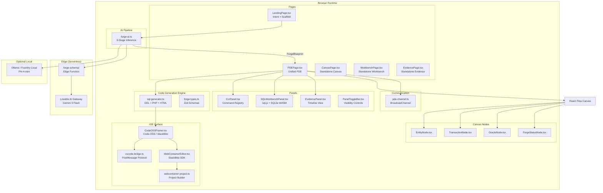
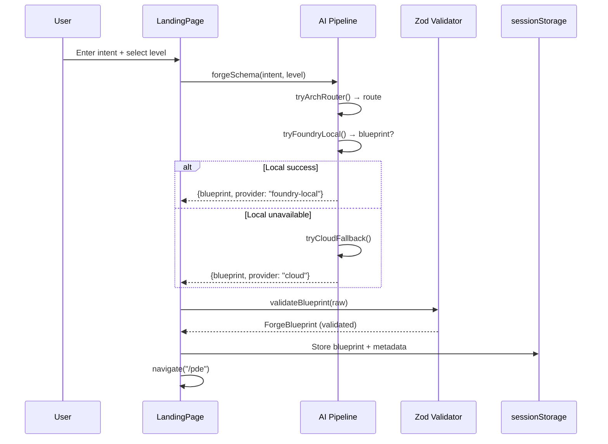
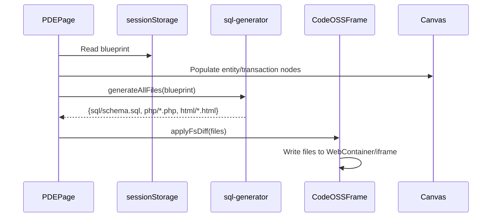
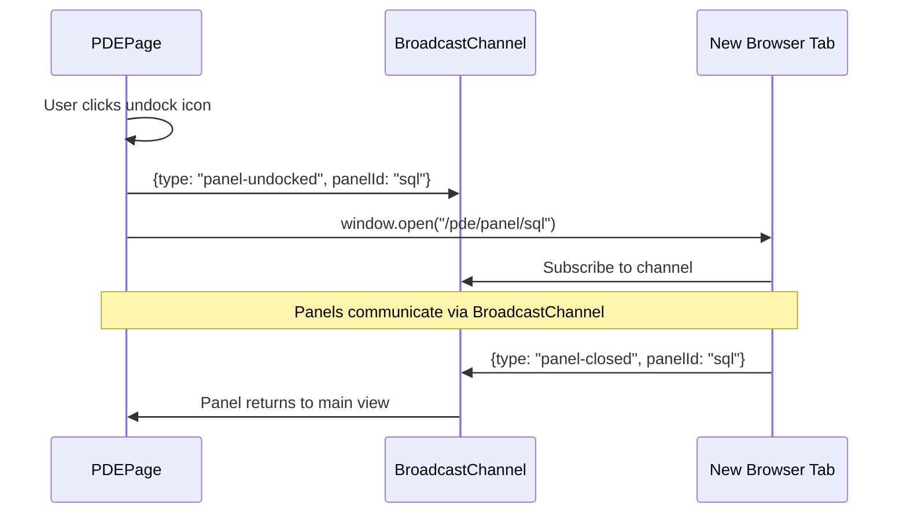

# System Architecture

## Overview

LAMPForge follows a **client-heavy architecture** where the browser is the primary compute surface. All code generation, SQL execution, and evidence logging happen client-side. The only server-side component is the AI blueprint generation edge function.

---

## High-Level Architecture

---

## Data Flow

### 1. Intent → Blueprint

### 2. Blueprint → Code

### 3. Panel Undocking

---

## Component Relationships

### Page → Component Map

| Page | Key Components |
|------|---------------|
| `LandingPage` | Template gallery, scaffold selector, intent textarea |
| `PDEPage` | `CodeOSSFrame`, `CLIPanel`, `SQLWorkbenchPanel`, `EvidencePanel`, `PanelToggleBar`, React Flow canvas |
| `CanvasPage` | React Flow canvas, `WebContainerEditor`, `TerminalPanel` |
| `WorkbenchPage` | `CodeEditor` (Monaco), results table |
| `EvidencePage` | Timeline cards, SDLC stage sidebar |

### Library → Consumer Map

| Library | Consumed By |
|---------|------------|
| `forge-ai.ts` | `LandingPage` |
| `forge-types.ts` | `forge-ai.ts`, `sql-generator.ts`, `pde-channel.ts`, `PDEPage`, `CanvasPage`, `CLIPanel`, `SQLWorkbenchPanel` |
| `sql-generator.ts` | `PDEPage`, `CanvasPage`, `CLIPanel`, `SQLWorkbenchPanel` |
| `vscode-bridge.ts` | `CodeOSSFrame` |
| `pde-channel.ts` | `PDEPage`, `PDEPanelPage` |
| `webcontainer-project.ts` | `WebContainerEditor` |

---

## Security Model

| Layer | Mechanism |
|-------|-----------|
| **Code-OSS iframe** | `sandbox="allow-scripts allow-same-origin allow-popups allow-forms"` |
| **PostMessage** | `lampforge:` prefix validation via `isLampforgeMessage()` |
| **Edge Function** | CORS headers, API key via `LOVABLE_API_KEY` env var |
| **Generated PHP** | CSRF tokens, PDO prepared statements (at Exemplary/RAD levels) |
| **Cross-Origin Isolation** | `COEP: require-corp`, `COOP: same-origin` headers in Vite config |

---

*This document is part of the LAMPForge doc-as-code suite. See [README.md](../README.md) for the full documentation index.*
