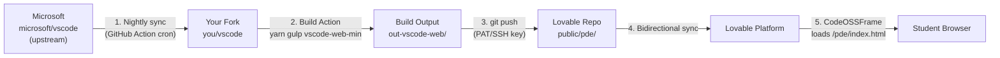

# Sovereign CI/CD Pipeline

## Overview

LAMPForge maintains a **sovereign build pipeline** for VS Code (Code - OSS) web. This document provides the complete technical setup guide.

---

## Why Sovereign?

| Aspect | Using `vscode.dev` | Sovereign Fork |
|--------|-------------------|----------------|
| **Telemetry** | Microsoft-controlled | Stripped/custom |
| **Extensions** | Marketplace only | Custom extension host |
| **Theming** | Standard themes | LAMPForge design tokens |
| **Availability** | Microsoft's SLA | Your GitHub + Lovable |
| **IP Ownership** | None | Full |
| **RAEng Score** | "Used VS Code" | "Engineered a pedagogical toolchain" |

---

## The Chain



---

## Step-by-Step Setup

### 1. Fork Microsoft/vscode

```bash
# On GitHub: Click "Fork" on https://github.com/microsoft/vscode
# Clone your fork locally
git clone https://github.com/YOUR_USERNAME/vscode.git
cd vscode
```

### 2. Create the Build Workflow

Create `.github/workflows/forge-build.yml` in your fork:

```yaml
name: LAMPForge Code-OSS Build

on:
  push:
    branches: [main]
  schedule:
    # Sync and build nightly at 2am UTC
    - cron: '0 2 * * *'
  workflow_dispatch: # Manual trigger

jobs:
  sync-upstream:
    runs-on: ubuntu-latest
    steps:
      - uses: actions/checkout@v4
        with:
          fetch-depth: 0
          token: ${{ secrets.GITHUB_TOKEN }}

      - name: Sync with upstream Microsoft/vscode
        run: |
          git remote add upstream https://github.com/microsoft/vscode.git || true
          git fetch upstream main
          git merge upstream/main --no-edit || echo "No changes to merge"
          git push origin main

  build-web:
    needs: sync-upstream
    runs-on: ubuntu-latest
    timeout-minutes: 60
    steps:
      - uses: actions/checkout@v4

      - name: Setup Node.js
        uses: actions/setup-node@v4
        with:
          node-version: '20'

      - name: Install dependencies
        run: yarn install --frozen-lockfile

      - name: Build vscode-web (minified)
        run: yarn gulp vscode-web-min

      - name: Upload build artefact
        uses: actions/upload-artifact@v4
        with:
          name: vscode-web
          path: out-vscode-web/
          retention-days: 7

  push-to-lovable:
    needs: build-web
    runs-on: ubuntu-latest
    steps:
      - name: Download build artefact
        uses: actions/download-artifact@v4
        with:
          name: vscode-web
          path: vscode-web-build/

      - name: Clone Lovable repo
        run: |
          git clone https://x-access-token:${{ secrets.LOVABLE_REPO_PAT }}@github.com/YOUR_USERNAME/YOUR_LOVABLE_REPO.git lovable-repo
          cd lovable-repo

      - name: Replace public/pde/ contents
        run: |
          cd lovable-repo
          rm -rf public/pde/*
          cp -r ../vscode-web-build/* public/pde/
          
      - name: Commit and push
        run: |
          cd lovable-repo
          git config user.name "LAMPForge CI"
          git config user.email "ci@lampforge.dev"
          git add public/pde/
          git diff --staged --quiet || git commit -m "chore: update Code-OSS web build [$(date +%Y-%m-%d)]"
          git push
```

### 3. Configure Secrets

In your **vscode fork** repository settings → Secrets and variables → Actions:

| Secret | Value | Purpose |
|--------|-------|---------|
| `LOVABLE_REPO_PAT` | GitHub Personal Access Token | Push access to your Lovable repo |

The PAT needs `repo` scope for the Lovable repository.

### 4. Verify the Pipeline

1. Push a commit to your fork's `main` branch (or click "Run workflow" manually)
2. Watch the GitHub Actions tab for the three jobs to complete
3. Check your Lovable repo — `public/pde/` should now contain the Code-OSS web build
4. Lovable automatically picks up the changes via bidirectional GitHub sync
5. Navigate to `/pde` in your LAMPForge app — the `CodeOSSFrame` should load Code-OSS instead of the StackBlitz fallback

---

## Fallback Strategy

The `CodeOSSFrame` component (`src/components/ide/CodeOSSFrame.tsx`) implements automatic fallback:

```
On mount:
  1. HEAD request to /pde/index.html
  2. If 200 → render <iframe src="/pde/index.html">
  3. If 404 → render <WebContainerEditor> (StackBlitz)
```

This means:
- **Before first CI/CD build**: StackBlitz WebContainer works immediately
- **After CI/CD build**: Code-OSS loads automatically
- **If CI/CD breaks**: Falls back to StackBlitz gracefully

---

## PostMessage Protocol

Communication between the PDE parent and the Code-OSS iframe uses the `lampforge:` message protocol defined in `src/lib/vscode-bridge.ts`:

### Parent → iframe

| Message Type | Payload | Purpose |
|-------------|---------|---------|
| `lampforge:open-file` | `{ path: string }` | Open a file in the editor |
| `lampforge:write-file` | `{ path: string, content: string }` | Create/update a file |
| `lampforge:set-theme` | `{ theme: "vs-dark" \| "vs-light" }` | Switch editor theme |

### iframe → Parent

| Message Type | Payload | Purpose |
|-------------|---------|---------|
| `lampforge:ready` | `{}` | Editor has finished initialising |
| `lampforge:file-saved` | `{ path: string, content: string }` | User saved a file |

---

## Cross-Origin Isolation

Code-OSS web requires `SharedArrayBuffer` for its worker threads. The Vite dev server is configured with the necessary headers in `vite.config.ts`:

```typescript
server: {
  headers: {
    "Cross-Origin-Embedder-Policy": "require-corp",
    "Cross-Origin-Opener-Policy": "same-origin",
  }
}
```

**Note**: These headers may affect other iframes or external resources. If you encounter CORS issues with other embeds, you may need to add `crossorigin` attributes or adjust the policy.

---

## Maintenance

### Automatic Updates
The nightly cron job (`0 2 * * *`) automatically:
1. Syncs your fork with Microsoft's upstream
2. Builds the web version
3. Pushes to your Lovable repo

### Manual Updates
Trigger a manual build via the GitHub Actions UI → "Run workflow" button.

### Monitoring
- Check the Actions tab in your fork for build failures
- Common failures: Node.js version mismatch, yarn lockfile changes, upstream breaking changes
- If a build fails, the previous build remains in `public/pde/` — the app continues working

---

*This document is part of the LAMPForge doc-as-code suite. See [README.md](../README.md) for the full documentation index.*
