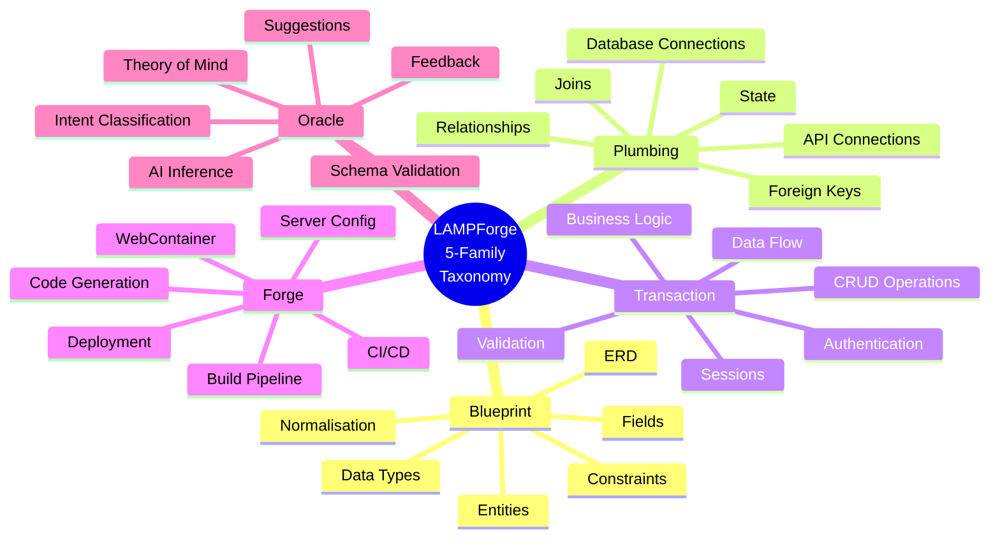
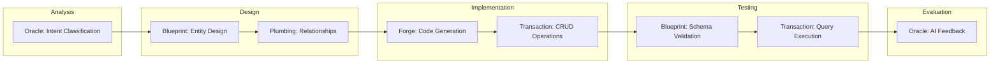

# The 5-Family Cognitive Taxonomy

## Overview

The 5-Family Taxonomy is LAMPForge's organising principle. It provides a **colour-coded cognitive framework** that maps every concept, UI element, and code artefact to one of five families. This taxonomy is inspired by the idea that students learn better when they can **categorise and relate** concepts rather than encounter them in isolation.

---

## The Five Families



---

## Family Details

### 🔵 Blueprint — *"The What"*

**Colour**: `hsl(210, 100%, 60%)` — Blue  
**CSS Token**: `--forge-blueprint`  
**Canvas Node**: `EntityNode.tsx`

The Blueprint family encompasses everything related to **data modelling**:

| Concept | WJEC Mapping | Example |
|---------|-------------|---------|
| Entity design | Unit 4.1 — Database design | `CREATE TABLE users (...)` |
| Field specification | Unit 4.1 — Data types | `VARCHAR(255)`, `INT`, `DATETIME` |
| Constraints | Unit 4.1 — Validation | `PRIMARY KEY`, `NOT NULL`, `UNIQUE` |
| Normalisation | Unit 4.1 — Normalisation | 1NF → 2NF → 3NF |
| Indexes | Unit 4.2 — Performance | `CREATE INDEX idx_users_email` |

**In the UI**:
- Entity nodes on the canvas have blue headers
- Blueprint-related CLI output is blue
- Evidence logs tagged with "Design" use the blueprint colour

---

### 🟢 Plumbing — *"How They Connect"*

**Colour**: `hsl(142, 72%, 50%)` — Green  
**CSS Token**: `--forge-plumbing`  
**Canvas Edge Colour**: `hsl(142, 72%, 50%)`

The Plumbing family covers **connectivity and relationships**:

| Concept | WJEC Mapping | Example |
|---------|-------------|---------|
| Foreign keys | Unit 4.1 — Relationships | `FOREIGN KEY (user_id) REFERENCES users(id)` |
| Cardinality | Unit 4.1 — ERD notation | `1:1`, `1:M`, `M:M` |
| Junction tables | Unit 4.1 — M:M resolution | `CREATE TABLE book_author (...)` |
| Cascade rules | Unit 4.2 — Referential integrity | `ON DELETE CASCADE` |
| Database connections | Unit 4.2 — PHP connectivity | `$pdo = new PDO(...)` |

**In the UI**:
- Relationship edges on the canvas are green
- `db_connect.php` output in CLI is green
- SQL comments (`--`) are green in terminal output

---

### 🟠 Transaction — *"What Happens"*

**Colour**: `hsl(32, 95%, 60%)` — Orange  
**CSS Token**: `--forge-transaction`  
**Canvas Node**: `TransactionNode.tsx`

The Transaction family encompasses **operations and logic**:

| Concept | WJEC Mapping | Example |
|---------|-------------|---------|
| CRUD operations | Unit 4.2 — Data manipulation | `INSERT INTO`, `SELECT`, `UPDATE`, `DELETE` |
| Form handling | Unit 4.2 — User input | `$_POST['name']`, `$_GET['id']` |
| Sessions | Unit 4.2 — State management | `session_start()`, `$_SESSION` |
| CSRF protection | Unit 4.2 — Security | `bin2hex(random_bytes(32))` |
| Pagination | Unit 4.2 — UX | `LIMIT :limit OFFSET :offset` |

**In the UI**:
- Transaction nodes on the canvas have orange headers
- The LAMPForge flame icon uses the transaction colour
- The "RAD 2.0" badge uses transaction orange

---

### 🔴 Forge — *"How It's Built"*

**Colour**: `hsl(0, 72%, 55%)` — Red  
**CSS Token**: `--forge-forge`  
**Canvas Node**: `ForgeStatusNode.tsx`

The Forge family covers **provisioning and generation**:

| Concept | WJEC Mapping | Example |
|---------|-------------|---------|
| Code generation | Unit 4.3 — Implementation | `generatePHPCrud()`, `generateHTMLForm()` |
| Build pipeline | Unit 4.4 — Deployment | GitHub Actions, `vscode-web-min` |
| Server configuration | Unit 4.3 — Environment | Vite config, Express server |
| WebContainer | Unit 4.3 — Runtime | StackBlitz SDK, Node.js in browser |
| Scaffold levels | Unit 4.3 — Differentiation | Exploratory → RAD 2.0 |

**In the UI**:
- Forge status nodes on the canvas are red
- The terminal traffic light dots include a red dot
- Build/generation progress indicators use red

---

### 🟣 Oracle — *"The Why"*

**Colour**: `hsl(270, 70%, 65%)` — Purple  
**CSS Token**: `--forge-oracle`  
**Canvas Node**: `OracleNode.tsx`

The Oracle family encompasses **AI reasoning and validation**:

| Concept | WJEC Mapping | Example |
|---------|-------------|---------|
| Intent classification | Unit 4.1 — Requirements | Arch-Router: `"schema_generation"` |
| Blueprint generation | Unit 4.1 — Design | Gemini/Phi-4 tool-calling |
| Schema validation | Unit 4.1 — Verification | Zod cross-reference checks |
| Suggestions | Unit 4.3 — Optimisation | "Consider adding an index on email" |
| Theory of Mind | Unit 4.4 — Evaluation | Adapting output to scaffold level |

**In the UI**:
- Oracle nodes on the canvas have purple headers with a brain icon
- Undocked panel indicators are purple
- The "Cognitive Engineering Platform" badge uses oracle purple sparkles

---

## How the Taxonomy Maps to the SDLC



---

## Design Token Reference

```css
/* Light Mode */
:root {
  --forge-blueprint: 210 100% 56%;
  --forge-plumbing: 142 72% 45%;
  --forge-transaction: 32 95% 55%;
  --forge-forge: 0 72% 51%;
  --forge-oracle: 270 70% 60%;
}

/* Dark Mode */
.dark {
  --forge-blueprint: 210 100% 60%;
  --forge-plumbing: 142 72% 50%;
  --forge-transaction: 32 95% 60%;
  --forge-forge: 0 72% 55%;
  --forge-oracle: 270 70% 65%;
}
```

Usage in components:
```tsx
<span className="text-forge-blueprint">Entity node</span>
<span className="text-forge-plumbing">Relationship edge</span>
<span className="text-forge-transaction">CRUD operation</span>
<span className="text-forge-forge">Build status</span>
<span className="text-forge-oracle">AI validation</span>
```

---

*This document is part of the LAMPForge doc-as-code suite. See [README.md](../README.md) for the full documentation index.*
