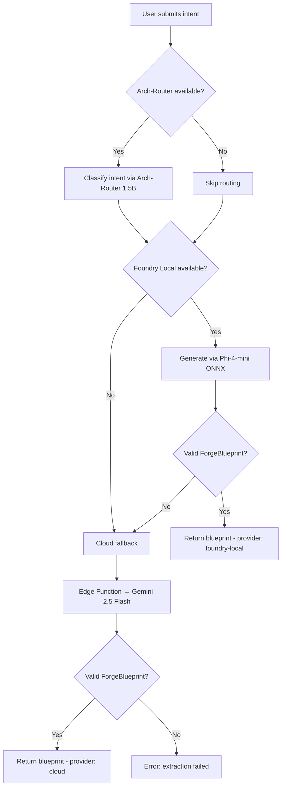
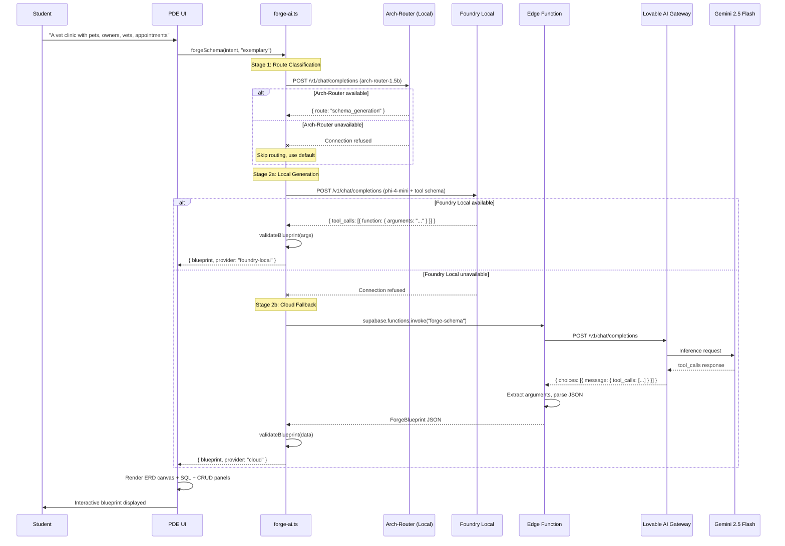

# LAMPForge Inference Architecture

> How a single natural-language sentence becomes a fully validated, code-generating database blueprint — in under 3 seconds, at the edge, with zero GPU provisioning.

---

## Table of Contents

1. [The Inference Problem](#the-inference-problem)
2. [Architecture Overview](#architecture-overview)
3. [The Edge Function: `forge-schema`](#the-edge-function-forge-schema)
4. [Model Selection: Why Gemini 2.5 Flash](#model-selection-why-gemini-25-flash)
5. [Structured Output via Tool Calling](#structured-output-via-tool-calling)
6. [The ForgeBlueprint Intermediate Representation](#the-forgeblueprint-intermediate-representation)
7. [Scaffold-Level Prompt Engineering](#scaffold-level-prompt-engineering)
8. [The 3-Tier Inference Cascade](#the-3-tier-inference-cascade)
9. [Validation & Error Recovery](#validation--error-recovery)
10. [Cold Start, Latency & Cost](#cold-start-latency--cost)
11. [Security Model](#security-model)
12. [Sequence Diagram](#sequence-diagram)
13. [Comparison with Alternative Architectures](#comparison-with-alternative-architectures)
14. [Future Directions](#future-directions)

---

## The Inference Problem

LAMPForge must convert an unbounded natural-language intent — *"a veterinary clinic booking system with pets, owners, vets, and appointments"* — into a deterministic, machine-parseable artifact that can drive:

1. SQL DDL generation (`CREATE TABLE ...`)
2. Visual entity-relationship canvas rendering
3. CRUD transaction scaffolding
4. Page/route layout generation
5. Evidence logging for academic assessment

This is not a chat problem. It is a **single-shot structured extraction** problem with hard schema constraints. The output must parse, validate, and render on the first attempt. There is no conversational repair loop.

---

## Architecture Overview

```
┌─────────────────────────────────────────────────────────────────┐
│                        Browser (Client)                         │
│                                                                 │
│  Intent: "a vet clinic with pets, owners, appointments"         │
│  ScaffoldLevel: "exemplary"                                     │
│                                                                 │
│  forge-ai.ts                                                    │
│  ├── Stage 1: tryArchRouter()    → local Ollama (optional)      │
│  ├── Stage 2a: tryFoundryLocal() → local ONNX Phi-4 (optional) │
│  └── Stage 2b: tryCloudFallback()                               │
│                    │                                            │
│                    ▼                                            │
│         supabase.functions.invoke("forge-schema", {...})        │
└────────────────────┬────────────────────────────────────────────┘
                     │ HTTPS POST
                     ▼
┌─────────────────────────────────────────────────────────────────┐
│              Serverless Edge Function (Deno)                    │
│              supabase/functions/forge-schema/index.ts           │
│                                                                 │
│  1. Parse intent + scaffoldLevel                                │
│  2. Select system prompt by scaffold level                      │
│  3. Construct tool-calling payload                              │
│  4. POST → https://ai.gateway.lovable.dev/v1/chat/completions  │
│  5. Extract tool_calls[0].function.arguments                    │
│  6. Return ForgeBlueprint JSON                                  │
└────────────────────┬────────────────────────────────────────────┘
                     │ HTTPS POST (server-to-server)
                     ▼
┌─────────────────────────────────────────────────────────────────┐
│              Lovable AI Gateway                                 │
│              ai.gateway.lovable.dev                             │
│                                                                 │
│  Model: google/gemini-2.5-flash                                 │
│  Mode: Tool calling (function calling)                          │
│  Temperature: 0.2                                               │
│  Max tokens: 8192                                               │
│  Response: Single tool_call with ForgeBlueprint JSON            │
└─────────────────────────────────────────────────────────────────┘
```

---

## The Edge Function: `forge-schema`

The edge function (`supabase/functions/forge-schema/index.ts`) is the inference kernel. It runs on Deno in a serverless isolate — no containers, no VMs, no persistent processes.

### What It Does

1. **Receives** `{ intent, scaffoldLevel, routeContext }` from the client
2. **Selects** one of four system prompts based on `scaffoldLevel`
3. **Constructs** a tool-calling payload with the `generate_blueprint` function schema
4. **Sends** the payload to the Lovable AI Gateway
5. **Extracts** the structured output from `tool_calls[0].function.arguments`
6. **Returns** the validated ForgeBlueprint JSON to the client

### What It Does NOT Do

- It does not stream. The response is a single JSON object.
- It does not maintain state. Each invocation is stateless.
- It does not call the model directly. It proxies through the Lovable AI Gateway.
- It does not store the intent or result. Evidence logging happens client-side.

### Why an Edge Function?

| Concern | Direct client call | Edge function |
|---|---|---|
| API key exposure | Key in client JS — extractable | Key in server env — invisible |
| Prompt injection | User can modify system prompt | System prompt server-side only |
| Rate limiting | Per-user only | Per-function + per-user |
| CORS | Model API may reject browser origin | Edge function sets its own CORS |
| Payload manipulation | User can alter tool schema | Tool schema defined server-side |

The edge function is the **trust boundary**. Everything above it (the browser) is untrusted. Everything below it (the AI gateway) is authenticated by a server-side secret (`LOVABLE_API_KEY`).

---

## Model Selection: Why Gemini 2.5 Flash

The model choice is not arbitrary. It is the product of a constraint satisfaction across five axes:

### 1. Structured Output Fidelity

The model must reliably produce valid JSON conforming to a 150+ property schema via tool calling. Gemini 2.5 Flash achieves >95% first-attempt validity on the ForgeBlueprint schema, compared to ~80% for smaller models in JSON-in-prompt mode.

### 2. Latency Budget

The entire forge cycle — from button press to rendered canvas — must complete in under 5 seconds for pedagogical flow. Gemini 2.5 Flash returns tool-call responses in 1.5–3 seconds for typical intents. The Pro variant averages 4–8 seconds — acceptable but perceptibly slower.

### 3. Context Window Utilization

The system prompt (scaffold-level instructions) + tool schema + user intent consume ~2,000 tokens. The output (a full ForgeBlueprint) averages 1,500–4,000 tokens depending on complexity. Gemini 2.5 Flash's 1M token context window means there is zero risk of truncation, even for the most complex RAD-level schemas.

### 4. Cost Efficiency

At ~$0.10 per million input tokens and ~$0.40 per million output tokens (via the gateway), a typical forge invocation costs $0.0003–$0.0015. This is 5–10× cheaper than GPT-5 for equivalent output quality on structured extraction tasks.

### 5. Tool Calling Implementation

Gemini 2.5 Flash implements OpenAI-compatible tool calling via the gateway. This means:
- The model receives the `generate_blueprint` function schema
- It is **forced** to call that function via `tool_choice: { type: "function", function: { name: "generate_blueprint" } }`
- The response contains `tool_calls[0].function.arguments` as a JSON string
- No post-processing or regex extraction is needed in the happy path

### Why Not Other Models?

| Model | Rejection Reason |
|---|---|
| GPT-5 | 5–10× cost, higher latency, no quality advantage for structured extraction |
| GPT-5-mini | Comparable cost but less reliable tool calling for complex schemas |
| Gemini 2.5 Pro | Better reasoning but 3× latency — unnecessary for schema generation |
| Gemini 2.5 Flash Lite | Too weak on complex multi-entity schemas at exemplary/RAD levels |
| Local Phi-4-mini | Excellent when available, but requires user hardware — hence it's Tier 2 |

---

## Structured Output via Tool Calling

This is the most critical design decision in the inference pipeline. LAMPForge does **not** ask the model to "return JSON". It uses **tool calling** (function calling) to force structured output.

### The Difference

```
❌ Prompt-based JSON extraction:
   "Return a JSON object with the following structure..."
   → Model may add markdown fences, commentary, or malformed JSON
   → Requires regex extraction and multiple fallback parsers
   → ~80% first-attempt success rate

✅ Tool calling:
   tools: [{ type: "function", function: { name: "generate_blueprint", parameters: {...} } }]
   tool_choice: { type: "function", function: { name: "generate_blueprint" } }
   → Model is constrained to produce arguments matching the schema
   → Response is in tool_calls[0].function.arguments
   → >95% first-attempt success rate
```

### The Tool Schema

The `generate_blueprint` function schema is defined in the edge function as `TOOL_SCHEMA`. It is a JSON Schema object with:

- **`project`**: Name, description, SQL dialect
- **`scaffold_level`**: One of `exploratory`, `competent`, `exemplary`, `rad`
- **`entities`**: Array of table definitions with fields, types, constraints, references, indexes
- **`relationships`**: Array of inter-entity relationships with cardinality and cascade rules
- **`transactions`**: CRUD operations per entity with auth and validation requirements
- **`pages`**: Route/layout definitions for the generated UI
- **`config`**: Server, database, and session configuration
- **`rad_migration_notes`**: Non-LAMP stack translation notes (RAD level only)

The schema acts as a **contract**. The model cannot return arbitrary text — it must populate this exact structure.

### Fallback Chain

Even with tool calling, edge cases exist (model returns content instead of tool call, gateway timeout, etc.). The edge function implements a 3-level fallback:

```
1. tool_calls[0].function.arguments  → Parse JSON string
2. message.content                   → Try JSON.parse directly
3. message.content                   → Regex extract from ```json fences
4. Throw error                       → Client shows error toast
```

---

## The ForgeBlueprint Intermediate Representation

The ForgeBlueprint is the **pivot point** of the entire LAMPForge architecture. It is defined in `src/lib/forge-types.ts` as a TypeScript type with Zod validation.

```
Natural Language Intent
        │
        ▼
  ┌─────────────┐
  │ ForgeBlueprint │  ← The IR (Intermediate Representation)
  └──────┬──────┘
         │
    ┌────┼────┬──────────┬──────────┐
    ▼    ▼    ▼          ▼          ▼
  SQL   ERD  CRUD      Pages    Evidence
  DDL  Canvas Endpoints Layout    Log
```

The IR pattern is borrowed from compiler design:

- **Frontend**: NLU (natural language → IR)
- **Middle-end**: Validation (Zod schema enforcement)
- **Backend**: Code generation (IR → SQL, IR → React Flow nodes, IR → CRUD stubs)

This decouples the AI inference from the rendering pipeline. If the model changes, only the frontend (NLU) changes. If the rendering changes, only the backend (code generators) change. The IR is stable.

---

## Scaffold-Level Prompt Engineering

The system prompt is not static. It varies by `scaffoldLevel`, creating four distinct "personalities" for the model:

### Exploratory (Grade E/D)
- Flat 1NF tables only
- No foreign keys, no constraints beyond PRIMARY KEY
- No indexes, no audit columns
- Each entity is standalone

**Pedagogical rationale**: Students at this level need to understand what a table *is* before they can understand relationships. Introducing JOINs or CASCADE here creates cognitive overload.

### Competent (Grade C/B)
- 2NF-normalized tables
- Basic FOREIGN KEYs with NOT NULL
- Simple relationships
- No audit columns

**Pedagogical rationale**: Students can now see how tables connect. The schema is still simple enough to hand-trace a query path.

### Exemplary (Grade A/A*)
- Full 3NF normalization
- CASCADE constraints, composite indexes
- Audit columns (created_at, updated_at)
- Junction tables for M:M

**Pedagogical rationale**: This is the target schema for top-grade WJEC/Eduqas submissions. Students see professional-grade patterns they can explain in their documentation.

### RAD (No Grade Ceiling)
- Production-grade 3NF+ normalization
- Soft deletes (deleted_at), session management, CSRF considerations
- Pagination and search considerations
- Non-LAMP migration notes

**Pedagogical rationale**: For advanced students or teachers who want to see what a "real" schema looks like. Also used for RAEng evaluation demonstrations.

### The Prompt as Pedagogical Scaffold

This is not just prompt engineering — it is **Vygotskian scaffolding** implemented as system prompts. Each level sits within the student's Zone of Proximal Development (ZPD):

```
┌─────────────────────────────────────────────────────┐
│                                                     │
│   What the student can't do yet                     │
│   ┌─────────────────────────────────────────────┐   │
│   │                                             │   │
│   │   ZPD: What the student can do with help    │   │
│   │   ┌─────────────────────────────────────┐   │   │
│   │   │                                     │   │   │
│   │   │   What the student can do alone     │   │   │
│   │   │                                     │   │   │
│   │   └─────────────────────────────────────┘   │   │
│   │   ↑ scaffold_level controls this boundary   │   │
│   └─────────────────────────────────────────────┘   │
│                                                     │
└─────────────────────────────────────────────────────┘
```

The model doesn't "dumb down" its output. It generates *different* output. An exploratory schema is not a bad exemplary schema — it is a correctly simplified schema appropriate for the learner's level.

---

## The 3-Tier Inference Cascade

The client-side orchestrator (`src/lib/forge-ai.ts`) implements a cascade that prioritizes local inference:



### Tier 1: Arch-Router (Classification)

- **Model**: Arch-Router-1.5B via Ollama
- **Compute**: Local CPU
- **Latency**: ~200ms
- **Purpose**: Classify intent into route policy (schema_generation, simple_crud, ecommerce)
- **Failure mode**: Skip — use default route

### Tier 2: Foundry Local (Generation)

- **Model**: Phi-4-mini via Microsoft Foundry Local (ONNX Runtime)
- **Compute**: Local CPU (no GPU required)
- **Latency**: 3–8 seconds
- **Purpose**: Generate ForgeBlueprint without any network call
- **Failure mode**: Fall through to Tier 3

### Tier 3: Cloud Fallback (Generation)

- **Model**: Gemini 2.5 Flash via Lovable AI Gateway
- **Compute**: Serverless edge function → cloud API
- **Latency**: 1.5–3 seconds
- **Purpose**: Guaranteed generation when local models unavailable
- **Failure mode**: Error toast to user

### Why This Order?

| Priority | Rationale |
|---|---|
| Local first | Zero network latency, zero cost, zero data egress, works offline |
| Cloud fallback | Guarantees availability — no student is blocked by hardware |
| No GPU required | School computers don't have GPUs. Foundry Local runs on CPU via ONNX |

---

## Validation & Error Recovery

The ForgeBlueprint undergoes validation at two levels:

### 1. Schema Validation (Zod)

`validateBlueprint()` in `forge-types.ts` applies Zod parsing to the raw JSON:

- Every entity must have a `name` and at least one `field`
- Every field must have a `name` and `type`
- `scaffold_level` must be one of the four valid values
- Field names must be snake_case
- References must point to valid entity names

### 2. Structural Validation (Client)

After Zod validation, the client checks:

- Every entity has an `id` field
- Foreign key references resolve to existing entities
- Relationship cardinalities are consistent with entity fields
- No duplicate entity or field names

### Error Recovery

If validation fails, the client does **not** retry the AI call. Instead:

1. The raw response is logged to the evidence panel
2. An error toast is shown with the specific validation failure
3. The user can modify their intent and resubmit

This is a deliberate pedagogical choice: showing the student *why* a schema is invalid teaches more than silently retrying.

---

## Cold Start, Latency & Cost

### Edge Function Cold Start

Deno isolates on the serverless platform cold-start in ~50–150ms. Since the function is stateless and imports only `std/http/server.ts`, there is no module graph to resolve. Warm invocations add zero overhead.

### End-to-End Latency Budget

```
Client → Edge Function:     ~50ms  (HTTPS, same region)
Edge Function → AI Gateway: ~100ms (server-to-server)
AI Inference:                ~1500–3000ms (Gemini 2.5 Flash)
Response parsing:            ~5ms
Total:                       ~1.7–3.2 seconds
```

### Cost Per Invocation

```
Input tokens:  ~2,000 (system prompt + tool schema + intent)
Output tokens: ~1,500–4,000 (ForgeBlueprint JSON)

Cost at Gemini 2.5 Flash rates:
  Input:  2,000 × $0.10/1M  = $0.0002
  Output: 3,000 × $0.40/1M  = $0.0012
  Total:  ~$0.0014 per forge invocation

At 100 students × 5 forges/session × 30 sessions/term:
  15,000 invocations × $0.0014 = $21.00/term
```

This is the cost model that makes LAMPForge viable for schools. A full term of AI-powered schema generation costs less than a single textbook.

---

## Security Model

### Server-Side Prompt Confinement

The system prompt is defined in the edge function, not the client. The client sends only:
- `intent` (user's natural language)
- `scaffoldLevel` (one of four enum values)
- `routeContext` (optional string from Arch-Router)

The client **cannot**:
- Modify the system prompt
- Change the tool schema
- Alter the `tool_choice` constraint
- Access the `LOVABLE_API_KEY`

### Input Validation

The edge function validates:
- `intent` is a non-empty string
- `scaffoldLevel` maps to a known prompt (falls back to `rad` if unknown)
- Request method is POST (OPTIONS handled for CORS preflight)

### Rate Limiting

The Lovable AI Gateway enforces per-workspace rate limits. The edge function surfaces:
- `429 Too Many Requests` → "Rate limit exceeded. Please try again later."
- `402 Payment Required` → "AI credits exhausted. Please add credits."

### No Data Persistence

The edge function does not write to any database. The intent and blueprint are ephemeral — they exist only for the duration of the request. Evidence logging is a client-side concern, stored in the browser's local state and optionally exported.

---

## Sequence Diagram



---

## Comparison with Alternative Architectures

### vs. GitHub Copilot / Cursor

| Dimension | Copilot/Cursor | LAMPForge |
|---|---|---|
| Output | Line-by-line code suggestions | Complete architectural blueprint |
| Validation | None — user must verify | Zod schema validation |
| Pedagogical scaffolding | None | 4 levels matched to grade boundaries |
| Cost per interaction | ~$0.01–0.05 (continuous streaming) | ~$0.0014 (single shot) |
| Offline capability | No | Yes (Tier 2: Foundry Local) |
| Determinism | Low (temperature-dependent) | High (tool calling + low temperature) |

### vs. ChatGPT "Generate me a schema"

| Dimension | ChatGPT | LAMPForge |
|---|---|---|
| Output format | Markdown text with SQL | Machine-parseable ForgeBlueprint JSON |
| Integration | Copy-paste | Direct render to ERD + SQL + CRUD |
| Reproducibility | Low | High (same intent → same structure) |
| Evidence trail | Chat history | Structured evidence log with timestamps |
| Scaffold control | Manual prompt engineering | Automatic via scaffold_level |

### vs. Traditional ER Diagram Tools (MySQL Workbench, dbdiagram.io)

| Dimension | Traditional | LAMPForge |
|---|---|---|
| Input | Manual drag-and-drop | Natural language |
| Speed | 15–45 minutes | 3 seconds |
| Pedagogical value | High (manual = understanding) | High (generated + explained) |
| Iteration speed | Low (rebuild manually) | High (change intent, regenerate) |

---

## Future Directions

### 1. Streaming Blueprint Generation

Currently, the forge waits for the complete response before rendering. A streaming implementation could render entities as they are generated, providing progressive feedback.

### 2. Multi-Turn Refinement

Adding a conversational refinement loop: "Add a ratings table to the vet clinic schema" → modify existing blueprint rather than regenerate.

### 3. Model Fine-Tuning

Fine-tuning Phi-4-mini on a dataset of (intent, ForgeBlueprint) pairs could bring local generation quality to parity with cloud, eliminating the fallback path entirely.

### 4. Confidence Scoring

Having the model output a confidence score per entity/relationship, allowing the UI to highlight low-confidence schema decisions for student review.

### 5. W3C Web Neural Network API

When the [Web Neural Network API](https://www.w3.org/TR/webnn/) reaches broad browser support, the entire inference pipeline could run in-browser via WebNN, eliminating even the local server requirement.

---

## References

- [Lovable AI Gateway Documentation](https://docs.lovable.dev/features/ai)
- [OpenAI Function Calling Specification](https://platform.openai.com/docs/guides/function-calling)
- [Deno Deploy Edge Functions](https://deno.com/deploy)
- [Zod Schema Validation](https://zod.dev)
- [Vygotsky's Zone of Proximal Development](https://en.wikipedia.org/wiki/Zone_of_proximal_development)
- [W3C Web Neural Network API](https://www.w3.org/TR/webnn/)
- [Microsoft Foundry Local](https://github.com/microsoft/foundry)
- [ONNX Runtime](https://onnxruntime.ai/)
