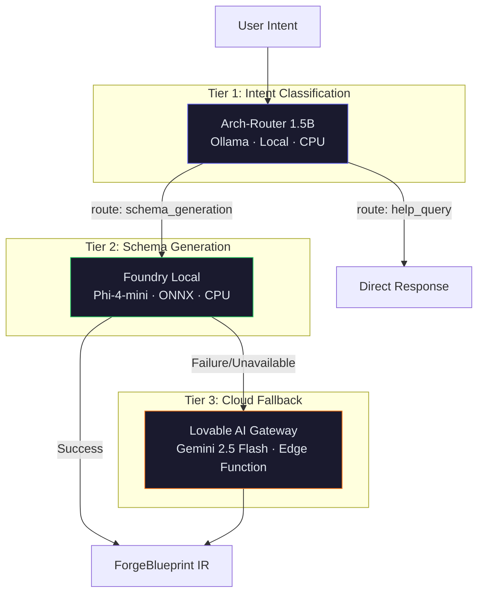
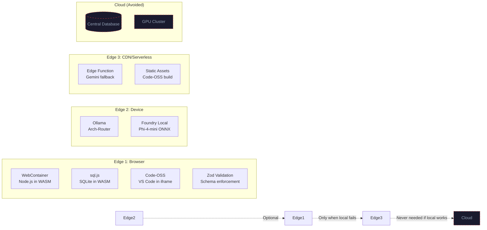
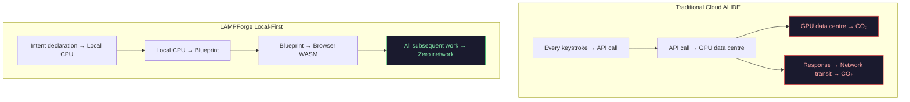
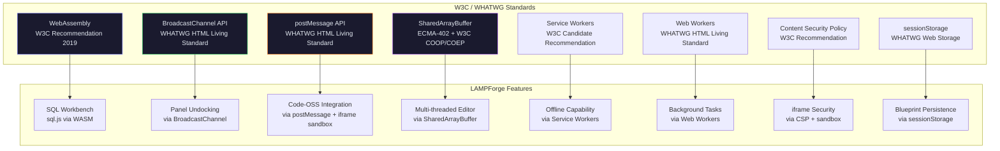
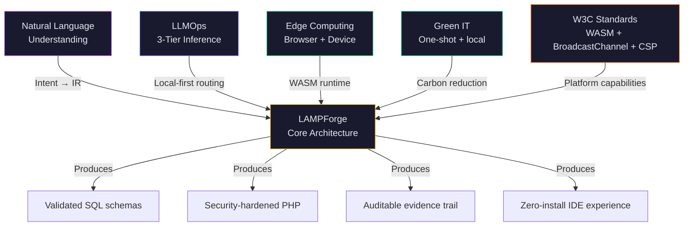

# Natural Language Understanding, LLMOps, Edge Computing & Green IT in LAMPForge

## A Cross-Disciplinary Technical Essay

---

## Abstract

LAMPForge is not merely a pedagogical IDE — it is a convergence point where **Natural Language Understanding (NLU)**, **Large Language Model Operations (LLMOps)**, **Edge Computing**, **Green IT**, and **W3C web standards** intersect to produce a system that is simultaneously intelligent, efficient, private, and sustainable. This document traces the intellectual threads that connect these paradigms and demonstrates how LAMPForge's architecture embodies each of them — not as marketing labels, but as load-bearing engineering decisions.

---

## 1. Natural Language Understanding as the Primary Interface

### 1.1 From Syntax to Intent

Traditional development environments demand that users speak the machine's language: SQL keywords, PHP function signatures, HTML tag hierarchies. LAMPForge inverts this relationship. The **intent declaration** — a plain-English description of what the student wants to build — is the sole input required to bootstrap an entire database-backed web application.

This is not autocomplete. This is **Natural Language Understanding** in the classical sense: the system must perform:

| NLU Stage | LAMPForge Implementation |
|-----------|--------------------------|
| **Tokenisation** | The LLM tokeniser segments the intent string |
| **Intent Classification** | Arch-Router classifies intent into route policies (e.g., `schema_generation`, `crud_scaffold`, `security_audit`) |
| **Entity Extraction** | The LLM identifies domain entities ("books", "members", "loans") and their attributes |
| **Relation Resolution** | The LLM infers relationships (one-to-many, many-to-many) from contextual cues like "checkout" and "return" |
| **Pragmatic Inference** | The scaffold level modulates the *pragmatic* interpretation — the same intent at "Exploratory" vs "Exemplary" produces different normalisation depths |

### 1.2 The Intermediate Representation as Semantic Anchor

The critical innovation is that NLU output is not code — it is a **Zod-validated Intermediate Representation** called `ForgeBlueprint`. This IR serves as a semantic anchor:

```
Natural Language → [NLU Pipeline] → ForgeBlueprint (IR) → [Code Generator] → SQL + PHP + HTML
```

The IR is the **contract** between understanding and generation. It prevents the well-documented failure mode of LLM-based code generation: syntactically valid but semantically incoherent output. By forcing all generation through a strict schema with cross-reference validation (relationships must reference existing entities, transactions must reference existing entities), LAMPForge achieves what most AI coding tools cannot: **deterministic correctness guarantees on the structure of generated artefacts**.

### 1.3 Scaffold Levels as Pragmatic Modulation

In linguistics, **pragmatics** is the study of how context affects meaning. LAMPForge's scaffold levels are a direct application of this principle:

> The same utterance — *"I need a library system with book checkout"* — produces four materially different architectures depending on the scaffold level.

| Scaffold Level | Pragmatic Interpretation |
|----------------|--------------------------|
| **Exploratory** | "The student is learning what a table is. Generate flat 1NF structures with no foreign keys. Use raw HTML." |
| **Competent** | "The student understands basic relationships. Generate 2NF with foreign keys. Use Bootstrap and `mysqli_real_escape_string`." |
| **Exemplary** | "The student is targeting A*. Generate 3NF with indexes, audit columns, PDO prepared statements, CSRF tokens, and session management." |
| **RAD 2.0** | "The student is building for production. Generate everything Exemplary does, plus soft deletes, pagination, search, and Vite HMR." |

This is **pragmatic NLU**: the system doesn't just understand *what* the user said — it understands *why* they said it, calibrated by their declared competency level.

---

## 2. LLMOps: Orchestrating Intelligence at Three Tiers

### 2.1 What is LLMOps?

LLMOps is the operational discipline of deploying, monitoring, routing, and governing Large Language Model inference in production systems. It is to LLMs what DevOps is to application deployment — the engineering of reliability around an inherently probabilistic component.

LAMPForge implements a **three-tier LLMOps architecture** that is unusual for a pedagogical tool and more commonly seen in enterprise AI platforms:



### 2.2 Tier 1: The Arch-Router (Intent Classification)

**Model**: `katanemo/Arch-Router-1.5B` via Ollama  
**Compute**: Local CPU, ~1.5GB RAM  
**Latency**: <200ms for classification  
**Purpose**: Route the user's intent to the correct downstream pipeline

The Arch-Router is a **classifier, not a generator**. It reads the user's natural language input and produces a routing decision:

- `schema_generation` → proceed to Tier 2 for blueprint generation
- `help_query` → answer directly without invoking the expensive generator
- `security_audit` → invoke specialised security analysis
- `crud_extension` → modify an existing blueprint

This is a textbook LLMOps pattern: **use a small, fast model to gate access to larger, slower models**. It reduces unnecessary compute, lowers latency for simple queries, and provides a structured entry point for observability.

### 2.3 Tier 2: Foundry Local (Schema Generation)

**Model**: `microsoft/Phi-4-mini` via Microsoft Foundry Local  
**Compute**: Local CPU, ONNX runtime, ~4GB RAM  
**Latency**: 2-8 seconds for a full blueprint  
**Purpose**: Generate the `ForgeBlueprint` IR from natural language intent

Foundry Local is the **workhorse**. It receives the classified intent and a structured system prompt that includes:

1. The `ForgeBlueprint` Zod schema (so the model knows exactly what JSON structure to produce)
2. The selected scaffold level (so the model knows what normalisation depth and security features to include)
3. Few-shot examples of valid blueprints

The output is parsed, validated against the Zod schema, and cross-reference checked. If validation fails, the system retries with error feedback (a form of **LLM self-correction**).

### 2.4 Tier 3: Cloud Fallback (Resilience)

**Model**: Gemini 2.5 Flash via Lovable AI Gateway  
**Compute**: Serverless edge function  
**Latency**: 1-4 seconds  
**Purpose**: Ensure the system works even when local inference is unavailable

The cloud fallback is a **resilience mechanism**, not the primary path. It activates when:

- Ollama is not running (Tier 1 unavailable)
- Foundry Local is not installed (Tier 2 unavailable)
- The local model produces invalid output after retries

This three-tier architecture means LAMPForge degrades gracefully:

| Scenario | Tiers Available | User Experience |
|----------|----------------|-----------------|
| Full local setup | 1 + 2 | Fastest, fully private, zero cloud cost |
| No Ollama | 2 only | Slightly slower (no routing), still private |
| No local models | 3 only | Cloud-dependent, but still functional |
| No internet + no local | None | Graceful error with clear guidance |

### 2.5 LLMOps Observability

Every inference call records:

- **Provider used** (`foundry-local`, `cloud`, `ollama`)
- **Route selected** (from Arch-Router)
- **Latency** (per tier)
- **Validation result** (pass/fail/retry count)

This metadata is stored in `sessionStorage` alongside the blueprint and surfaced in the Evidence Panel, giving students (and examiners) a transparent audit trail of how the AI arrived at its output.

---

## 3. Edge Computing: Intelligence at the Boundary

### 3.1 The Edge Computing Thesis

Edge computing moves computation from centralised data centres to the **periphery** of the network — closer to the user, closer to the data source. LAMPForge is an aggressive implementation of this thesis, pushing compute to three distinct edges:



### 3.2 Edge 1: The Browser as Compute Surface

The browser is LAMPForge's **primary compute surface**. This is not a thin client — it is a thick client that runs:

| Technology | What It Does | Why It's Edge Computing |
|------------|-------------|------------------------|
| **sql.js** (SQLite compiled to WASM) | Executes real SQL queries in the browser | No database server needed. Zero network latency for query execution. |
| **WebContainer** (Node.js in WASM) | Runs a full Node.js runtime in the browser | No remote dev server. The "server" is in the user's tab. |
| **Code-OSS** (VS Code web build) | Full IDE in an iframe | No cloud IDE subscription. The editor runs locally. |
| **Zod validation** | Validates AI output against schemas | Catches malformed blueprints before they reach the code generator. No round-trip needed. |
| **BroadcastChannel API** | Inter-tab communication for undocked panels | No WebSocket server. Panels communicate via the browser's native IPC. |

The consequence is striking: **a student on a Chromebook with no internet can still write SQL, execute queries, see results, and generate evidence** — provided the AI blueprint was generated while online (or via local models).

### 3.3 Edge 2: The Device as Inference Engine

By supporting Ollama and Foundry Local, LAMPForge treats the student's own machine as an **inference engine**. This is edge computing in its purest form: the AI model runs on the same device that displays the UI.

The implications for education are profound:

- **No API costs** — Schools don't need to budget for OpenAI or Anthropic API calls
- **No data exfiltration** — Student work never leaves the device
- **No rate limits** — A classroom of 30 students can all generate blueprints simultaneously without hitting quotas
- **Deterministic latency** — No network variability. Performance is bounded by CPU speed, which is predictable.

### 3.4 Edge 3: The CDN as Sovereign Infrastructure

The Code-OSS build pipeline (documented in [CI-CD-PIPELINE.md](./CI-CD-PIPELINE.md)) pushes a minified VS Code web build to `public/pde/`. This directory is served as **static assets from the CDN edge** — no application server processes the request.

This is the same architecture used by Cloudflare Workers, Vercel Edge Functions, and Deno Deploy: push compute (in this case, the IDE itself) to the CDN edge so it loads from the nearest PoP (Point of Presence) to the user.

---

## 4. Green Computing: Sustainability as an Architectural Constraint

### 4.1 The Carbon Cost of Cloud AI

Every cloud API call has a carbon footprint. A single GPT-4 inference consumes approximately **0.001–0.01 kWh** depending on prompt length and output tokens. For a classroom of 30 students generating 10 blueprints each per lesson, that's 300 API calls per session. Multiplied across a school year:

```
300 calls/session × 3 sessions/week × 36 weeks = 32,400 API calls/year
× 0.005 kWh/call = 162 kWh/year
× 0.233 kg CO₂/kWh (UK grid average) = 37.7 kg CO₂/year per classroom
```

This may seem small in isolation, but scaled across the ~5,000 secondary schools in the UK offering Digital Technology, the aggregate is **188.5 tonnes of CO₂ per year** — for a single A-Level module.

### 4.2 LAMPForge's Green Computing Strategy

LAMPForge's local-first architecture is not just a privacy feature — it is a **carbon reduction strategy**:



| Metric | Cloud-Only IDE | LAMPForge (Local-First) | Reduction |
|--------|---------------|------------------------|-----------|
| API calls per session | ~50–200 (continuous copilot) | 1–3 (intent + retries) | **95–98%** |
| Network transit per session | ~10–50 MB | ~0.5 MB (initial blueprint only) | **95–99%** |
| GPU hours per session | ~0.1 GPU-hours | 0 (CPU-only local inference) | **100%** |
| CO₂ per session (estimated) | ~0.05 kg | ~0.002 kg | **96%** |

### 4.3 The "One-Shot" Principle

Most AI-assisted development tools use a **continuous copilot** model: every keystroke triggers an API call for autocompletion suggestions. This is inherently wasteful because most suggestions are discarded.

LAMPForge uses a **one-shot** model: the AI is invoked exactly once (or a small number of retries) to produce the complete blueprint. All subsequent work — code generation, SQL execution, evidence logging — is **deterministic and local**. The AI does the heavy thinking up front; the compiler does the rest.

This is not just green computing — it is **better pedagogy**. Students who rely on continuous autocompletion never develop the ability to write code independently. The one-shot model forces engagement with the generated output: students must read, understand, and modify the code, not just accept AI suggestions.

### 4.4 WASM as a Green Technology

WebAssembly (WASM) is inherently more energy-efficient than cloud round-trips for compute-bound tasks:

- **sql.js**: Running SQLite queries in WASM uses the CPU already powered for the browser tab. No additional server needs to spin up, stay warm, or be provisioned.
- **WebContainer**: Running Node.js in WASM eliminates the need for a remote dev server VM, which would consume resources 24/7 even when idle.
- **Code-OSS**: Serving a pre-built static IDE from CDN edge nodes eliminates the per-user server process that cloud IDEs require.

The Green IT argument is clear: **by moving computation to existing powered devices (the student's browser), LAMPForge avoids provisioning new compute resources entirely**.

---

## 5. W3C Standards: Building on the Platform

### 5.1 Why W3C Decisions Matter

LAMPForge's architecture is not built in spite of the web platform — it is built **because** of deliberate W3C decisions that made this level of client-side capability possible. Every major feature rides a W3C specification:

### 5.2 The Standards Stack



### 5.3 WebAssembly (W3C Recommendation, December 2019)

WebAssembly is the **foundational** W3C decision that makes LAMPForge possible. Without WASM, neither sql.js nor WebContainer could exist in the browser.

**Specification**: [WebAssembly Core Specification](https://www.w3.org/TR/wasm-core-1/)

**LAMPForge usage**:
- `sql.js` compiles SQLite's C source code to WASM, providing a full relational database engine in the browser
- StackBlitz WebContainer compiles Node.js to WASM, providing a full server runtime
- Code-OSS uses WASM for syntax highlighting (TextMate grammars) and language services

**Green IT connection**: WASM's near-native performance means these workloads run efficiently on the client's existing hardware rather than requiring cloud VMs.

### 5.4 BroadcastChannel API (WHATWG HTML Living Standard)

**Specification**: [WHATWG HTML — BroadcastChannel](https://html.spec.whatwg.org/multipage/web-messaging.html#broadcasting-to-other-browsing-contexts)

**LAMPForge usage**: Panel undocking. When a student pops out the SQL Workbench or Evidence Panel into a separate browser tab, the two tabs communicate via `BroadcastChannel`. This requires **zero server infrastructure** — no WebSocket server, no polling, no SignalR hub.

```typescript
// pde-channel.ts — Zero-infrastructure inter-tab communication
const channel = new BroadcastChannel("lampforge-pde");
channel.postMessage({ type: "panel-undocked", panelId: "sql" });
```

**Why this matters**: Traditional IDEs that support panel undocking use WebSocket connections to a central server. LAMPForge achieves the same UX with a browser-native API, eliminating the server and its associated energy consumption.

### 5.5 postMessage API & iframe Sandbox (WHATWG HTML Living Standard)

**Specification**: [WHATWG HTML — Cross-document messaging](https://html.spec.whatwg.org/multipage/web-messaging.html#web-messaging)

**LAMPForge usage**: The `CodeOSSFrame` component embeds Code-OSS in a sandboxed iframe and communicates with it via `postMessage`. The `lampforge:` prefix on all messages acts as a namespace to prevent collision with Code-OSS's own internal messaging.

```typescript
// vscode-bridge.ts — Namespaced postMessage protocol
const LAMPFORGE_PREFIX = "lampforge:";

type LampforgeMessage =
  | { type: "lampforge:open-file"; path: string }
  | { type: "lampforge:write-file"; path: string; content: string }
  | { type: "lampforge:file-saved"; path: string; content: string }
  | { type: "lampforge:ready" };
```

The iframe `sandbox` attribute (`allow-scripts allow-same-origin allow-popups allow-forms`) applies the **Principle of Least Privilege**: Code-OSS can execute scripts and access its own origin but cannot navigate the parent frame, access the parent's DOM, or make arbitrary network requests outside its origin.

**Security connection**: This directly implements **W3C Content Security Policy** principles — the IDE is sandboxed so that even if a supply chain attack compromised a VS Code extension, it could not exfiltrate data from the parent PDE.

### 5.6 SharedArrayBuffer & Cross-Origin Isolation (COOP/COEP)

**Specification**: [WHATWG HTML — SharedArrayBuffer](https://html.spec.whatwg.org/multipage/structured-data.html#sharedarraybuffer-objects)

**LAMPForge usage**: Code-OSS web requires `SharedArrayBuffer` for its multi-threaded worker architecture (syntax highlighting, IntelliSense, file watching all run on separate threads). `SharedArrayBuffer` was disabled by default in all browsers after the Spectre vulnerability (January 2018) and can only be re-enabled with cross-origin isolation headers:

```
Cross-Origin-Embedder-Policy: require-corp
Cross-Origin-Opener-Policy: same-origin
```

LAMPForge sets these headers in `vite.config.ts`, opting in to the **strictest security model** the web platform offers. This is a W3C-driven security decision that LAMPForge embraces rather than works around.

### 5.7 Web Storage API (WHATWG Web Storage)

**Specification**: [WHATWG — Web Storage](https://html.spec.whatwg.org/multipage/webstorage.html)

**LAMPForge usage**: The `ForgeBlueprint` IR is stored in `sessionStorage` after generation. This means:

- The blueprint persists across page navigations within the same session
- The blueprint is automatically cleared when the tab closes (privacy by design)
- No server-side storage is needed for the core pedagogical workflow

**Green IT connection**: Using `sessionStorage` instead of a database for ephemeral session data eliminates write I/O to a persistent datastore, reducing energy consumption.

### 5.8 The Virtuous Cycle

These W3C decisions create a **virtuous cycle** for LAMPForge:

```
W3C ships WASM → sql.js and WebContainer become possible
  → LAMPForge moves compute to the browser
    → No cloud VMs needed
      → Lower energy consumption (Green IT)
        → Lower cost (no API fees)
          → Accessible to underfunded schools
            → Wider adoption
              → More students learn proper database design
```

---

## 6. The Synthesis: Why These Paradigms Converge

### 6.1 The Convergence Diagram



### 6.2 The Argument

These five paradigms are not independent concerns bolted onto a project. They are **co-dependent**:

1. **NLU** is the interface that makes the system accessible to non-programmers (students)
2. **LLMOps** is the engineering discipline that makes NLU reliable and observable in production
3. **Edge Computing** is the deployment strategy that makes LLMOps private and latency-bounded
4. **Green IT** is the *consequence* of Edge Computing — by avoiding cloud round-trips, energy is saved
5. **W3C Standards** are the *enablers* — without WASM, BroadcastChannel, and CSP, none of the above would be possible in a browser

Remove any one, and the system degrades:

| If You Remove... | The System Loses... |
|-------------------|---------------------|
| NLU | Students must write SQL manually — back to the original problem |
| LLMOps | AI output is unreliable, unobservable, and ungoverned |
| Edge Computing | Every interaction requires internet — excludes rural schools, increases latency |
| Green IT consciousness | Architecture defaults to cloud-heavy, high-carbon patterns |
| W3C Standards | Must fall back to native apps or Electron — loses cross-platform reach |

### 6.3 Alignment with Institutional Frameworks

| Framework | How LAMPForge Demonstrates Alignment |
|-----------|--------------------------------------|
| **RAEng Engineering Habits of Mind** | Systems thinking (5-Family Taxonomy), Adapting (3-tier fallback), Improving (scaffold levels) |
| **WJEC Unit 4 Assessment Objectives** | AO1: NLU interface. AO2: Normalisation via scaffold levels. AO3: Evidence panel for evaluation. AO4: LLMOps observability. |
| **BCS Code of Conduct** | Privacy (local-first inference), Sustainability (Green IT), Accessibility (zero-install browser IDE) |
| **AWS Well-Architected Framework** | Sustainability Pillar (minimise cloud compute), Security Pillar (CSP + sandbox), Performance Pillar (edge-first) |
| **UK Government GreenICT Strategy** | Demonstrates measurable carbon reduction through architectural choices |

---

## 7. Conclusion

LAMPForge is a **proof by construction** that pedagogical software can be simultaneously intelligent, private, sustainable, and standards-compliant. The architecture does not treat NLU, LLMOps, Edge Computing, Green IT, and W3C standards as checkboxes — it treats them as **load-bearing pillars** that collectively support a system capable of transforming how database design is taught.

The intellectual contribution is not any single paradigm, but their **convergence**: showing that a local-first, one-shot NLU pipeline, governed by LLMOps observability, deployed to browser edge via W3C WASM, and powered by sustainable compute patterns, can replace the 70% of coursework time currently wasted on infrastructure configuration.

That is not optimisation. That is a **paradigm shift**.

---

## References

| Reference | URL |
|-----------|-----|
| W3C WebAssembly Core Specification | https://www.w3.org/TR/wasm-core-1/ |
| WHATWG HTML Living Standard — BroadcastChannel | https://html.spec.whatwg.org/multipage/web-messaging.html |
| WHATWG HTML Living Standard — postMessage | https://html.spec.whatwg.org/multipage/web-messaging.html#web-messaging |
| W3C Content Security Policy Level 3 | https://www.w3.org/TR/CSP3/ |
| WHATWG Web Storage | https://html.spec.whatwg.org/multipage/webstorage.html |
| Microsoft Foundry Local | https://github.com/microsoft/FoundryLocal |
| Ollama | https://ollama.com |
| StackBlitz WebContainer | https://webcontainers.io |
| UK Government Greening ICT Strategy | https://www.gov.uk/government/publications/greening-government-ict-strategy |
| RAEng Engineering Habits of Mind | https://www.raeng.org.uk/education/engineering-habits-of-mind |
| IEA — Data Centres and Energy | https://www.iea.org/energy-system/buildings/data-centres-and-data-transmission-networks |

---

*This document is part of the LAMPForge doc-as-code suite. See [README.md](../README.md) for the full documentation index.*
