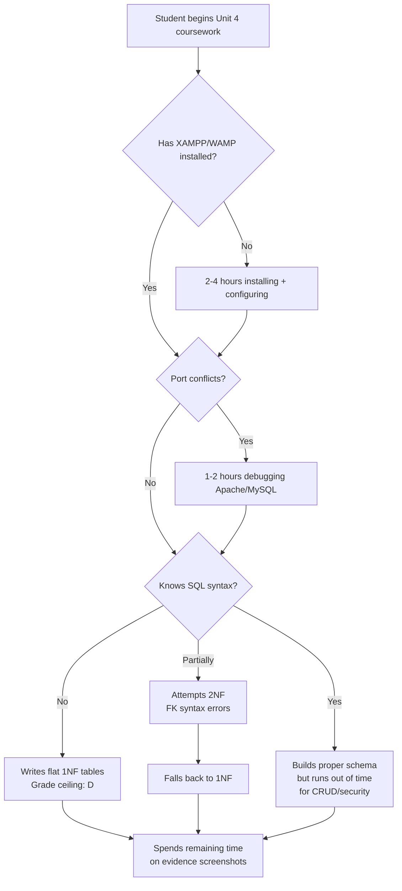

# Design Rationale — From First Thoughts to Final Implementation

## Document Purpose

This document traces the complete intellectual journey of LAMPForge — from the initial problem identification through intermediary explorations to the final architectural decisions. It serves as evidence of the iterative design process required by the WJEC/Eduqas SDLC framework.

---

## Phase 1: Problem Identification (First Thoughts)

### The Catalyst

The initial observation was stark: A-Level Digital Technology students were spending **70% of their coursework time** on infrastructure configuration rather than learning the core concepts of database design, normalisation, and CRUD operations.

### Root Cause Analysis



### Key Insights

1. **Infrastructure is not pedagogy** — Installing MySQL teaches nothing about relational algebra
2. **The grade distribution is bimodal** — Students either "get it" early and reach A/A*, or plateau at C/D
3. **Evidence collection is busywork** — Manual screenshots interrupt flow state
4. **Security patterns are beyond scope** — CSRF, prepared statements, session management are essential for A* but rarely taught

---

## Phase 2: Solution Space Exploration (Intermediary)

### Approach A: Pre-configured VM (Rejected)

**Idea**: Ship a VirtualBox image with LAMP pre-installed.

**Why rejected**:
- 4GB+ download size
- Different hardware = different bugs
- No live collaboration
- Still requires local MySQL knowledge

### Approach B: Cloud-hosted IDE (Partially adopted)

**Idea**: Use Replit, CodeSandbox, or Gitpod.

**Why partially adopted**:
- ✅ Zero installation
- ❌ No MySQL (only SQLite or PostgreSQL in free tiers)
- ❌ No PHP support in most browser IDEs
- ❌ External dependency — could shut down or change pricing
- ✅ The *concept* of in-browser development was sound

### Approach C: AI-assisted scaffolding (Adopted)

**Idea**: Use AI to translate natural language into database schemas.

**Why adopted**:
- ✅ Meets students where they are (natural language)
- ✅ Produces correct normalisation by scaffold level
- ✅ Generates boilerplate PHP CRUD code
- ✅ Can be validated against Zod schemas
- ⚠️ Risk: Students might not understand generated code → mitigated by scaffold levels

### The Synthesis: LAMPForge

The final architecture combines the best of B and C:
- **In-browser IDE** (from Approach B) via StackBlitz WebContainer
- **AI scaffolding** (from Approach C) via local-first inference with cloud fallback
- **Automatic evidence** — a novel addition that no existing tool provides

---

## Phase 3: Architectural Decisions (Final)

### Decision 1: The ForgeBlueprint Schema

**Problem**: AI models produce inconsistent JSON structures.

**Solution**: A strict Zod schema (`ForgeBlueprintSchema`) that validates every generated blueprint:

```typescript
ForgeBlueprint {
  version: string
  project: { name, description, dialect }
  scaffold_level: "exploratory" | "competent" | "exemplary" | "rad"
  entities: ForgeEntity[]      // min 1
  relationships: ForgeRelationship[]
  transactions: ForgeTransaction[]
  pages: ForgePage[]
  config: ForgeConfig
}
```

**Cross-reference validation** ensures referential integrity:
- Relationships must reference existing entities
- Transactions must reference existing entities
- Pages must reference existing entities

### Decision 2: Scaffold-Level Code Generation

**Problem**: A single code template doesn't serve all grade bands.

**Solution**: Four distinct code generation pathways, one per scaffold level:

| Component | Exploratory | Competent | Exemplary | RAD 2.0 |
|-----------|------------|-----------|-----------|---------|
| **DDL** | Flat tables, no FK | 2NF, basic FK | 3NF, indexes, audit | 3NF+, soft deletes |
| **PHP** | Raw `mysqli` | `mysqli_real_escape` | PDO + CSRF | PDO + pagination + search |
| **HTML** | Plain HTML | Bootstrap forms | Bootstrap + alerts + CSRF tokens | Bootstrap + Vite HMR |
| **Server** | Express (static) | Express (static) | Express (static) | Vite dev server |

### Decision 3: Local-First AI

**Problem**: Cloud AI requires internet and incurs costs.

**Solution**: A three-tier inference strategy:

1. **Arch-Router** (Ollama, optional) — Classifies intent into route policies
2. **Foundry Local** (Phi-4-mini) — Generates blueprint locally via tool-calling
3. **Cloud Fallback** (Gemini 3 Flash) — Edge function via Lovable AI gateway

This means LAMPForge works **offline** when Foundry Local or Ollama is running.

### Decision 4: The 5-Family Taxonomy

**Problem**: Students struggle to categorise what they're learning.

**Solution**: A colour-coded taxonomy that maps every concept to one of five families:

- 🔵 **Blueprint** — The "what" (data structures)
- 🟢 **Plumbing** — The "how they connect" (relationships)
- 🟠 **Transaction** — The "what happens" (operations)
- 🔴 **Forge** — The "how it's built" (generation)
- 🟣 **Oracle** — The "why" (AI reasoning)

This taxonomy permeates the entire UI: canvas node headers, CLI output colours, evidence log badges, and design tokens.

### Decision 5: Sovereign CI/CD for Code-OSS

**Problem**: Using `vscode.dev` in an iframe means depending on Microsoft's infrastructure and telemetry.

**Solution**: Fork `microsoft/vscode`, build `vscode-web-min` via GitHub Actions, and push the output to `public/pde/`. The `CodeOSSFrame` component:

1. Checks if `/pde/index.html` exists (HEAD request)
2. If yes → loads the sovereign Code-OSS build
3. If no → falls back to StackBlitz WebContainer

This creates an **IP moat**: we own the build pipeline, can strip telemetry, inject custom extensions, and ensure the IDE matches our design tokens.

---

## Phase 4: Evaluation & Reflection

### What Worked

1. **Zod validation** prevented malformed blueprints from crashing the PDE
2. **Scaffold levels** allowed differentiated instruction within a single tool
3. **In-browser SQLite** eliminated the #1 infrastructure barrier
4. **The 5-Family Taxonomy** gave students a mental model for organising concepts
5. **BroadcastChannel** for panel undocking was elegant and required zero server infrastructure

### What Could Be Improved

1. **PHP execution** — Currently PHP is displayed as source code, not executed. Integration with `php-wasm` would enable true in-browser PHP execution
2. **Collaborative editing** — The PDE is single-user. WebRTC or CRDT-based collaboration would enable pair programming
3. **Assessment rubric integration** — Automatic mapping of generated artefacts to WJEC mark scheme criteria
4. **Offline-first PWA** — Service worker caching for the entire PDE

### Alignment with RAEng Engineering Habits of Mind

| Habit | How LAMPForge Demonstrates It |
|-------|-------------------------------|
| **Systems thinking** | The 5-Family Taxonomy + architecture canvas |
| **Problem finding** | Intent declaration forces articulation of the problem |
| **Creative problem solving** | AI scaffolding provides multiple valid solutions |
| **Visualising** | React Flow canvas, Mermaid diagrams, colour-coded taxonomy |
| **Improving** | Scaffold levels show progressive improvement |
| **Adapting** | Local-first AI with cloud fallback; Code-OSS with StackBlitz fallback |

---

*This document is part of the LAMPForge doc-as-code suite. See [README.md](../README.md) for the full documentation index.*
