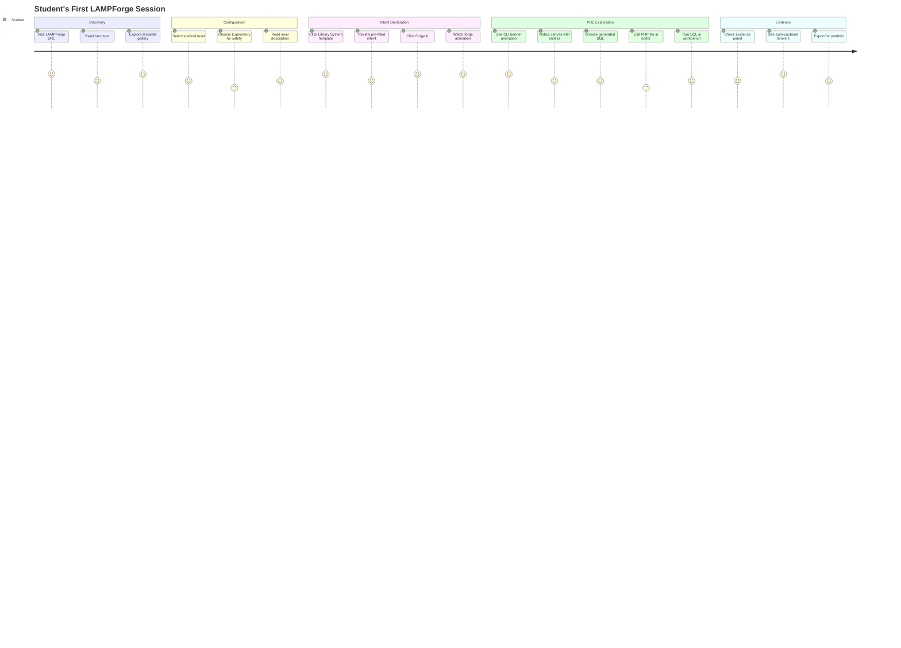
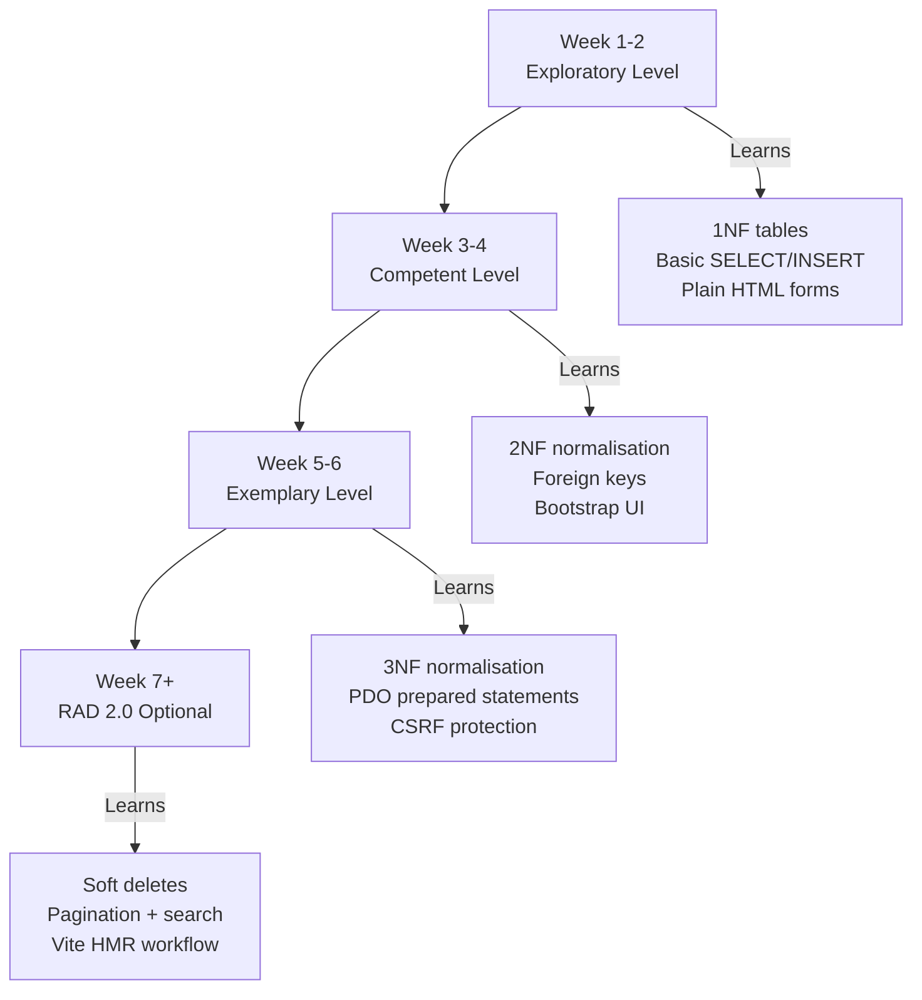
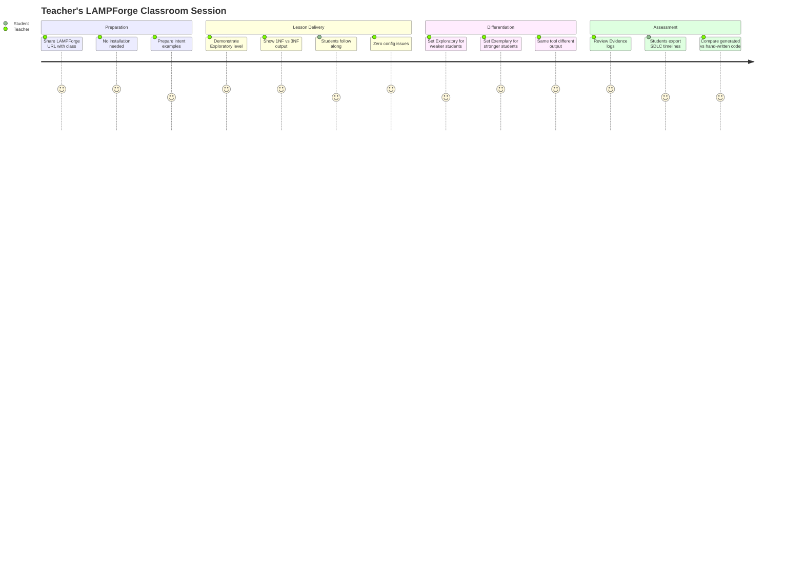
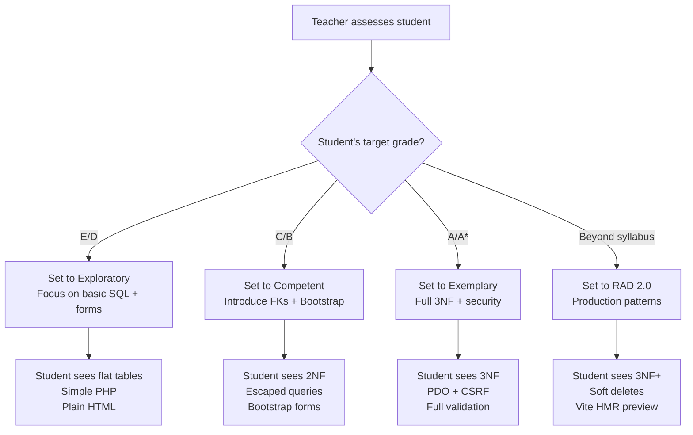
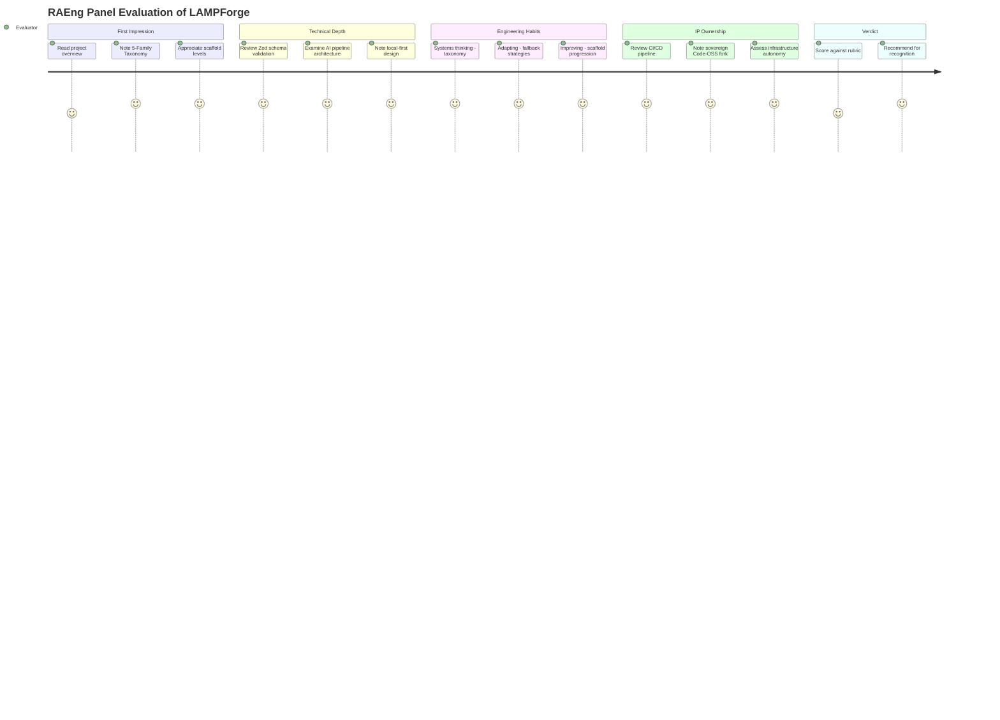
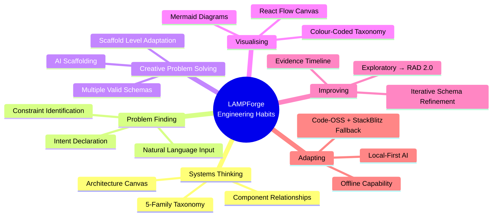
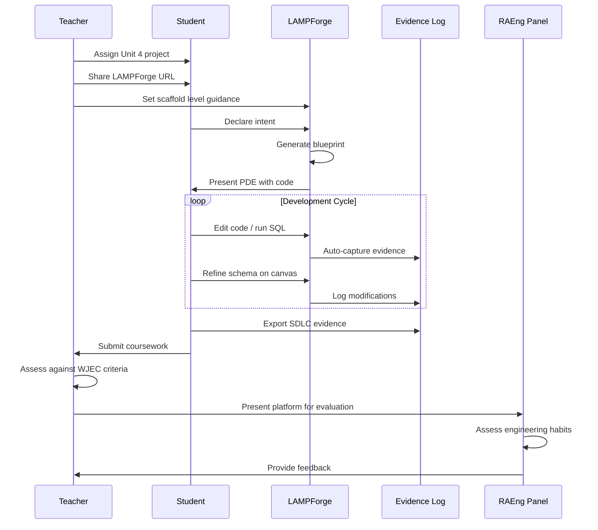

# User Journeys

## Overview

LAMPForge serves three primary user personas. This document maps their journeys through the platform with Mermaid diagrams.

---

## Persona 1: The A-Level Student

### Profile
- **Age**: 16-18
- **Goal**: Complete WJEC Unit 4 coursework (database-driven web application)
- **Pain**: Infrastructure setup, SQL syntax, evidence collection
- **Success**: Achieve target grade (E → A*) with a working application and complete SDLC evidence

### Journey: First-Time Use

### Journey: Progression Through Scaffold Levels

---

## Persona 2: The Teacher

### Profile
- **Role**: A-Level Digital Technology teacher
- **Goal**: Deliver Unit 4 effectively, help students achieve target grades
- **Pain**: Supporting 20+ students with different XAMPP configurations
- **Success**: All students submit working applications with complete evidence

### Journey: Classroom Deployment

### Teacher's Decision Matrix

---

## Persona 3: The RAEng Panel Evaluator

### Profile
- **Role**: Engineering education assessor
- **Goal**: Evaluate whether the tool demonstrates engineering habits of mind
- **Pain**: Assessing "is this just a wrapper around ChatGPT?"
- **Success**: Evidence of systematic engineering approach, IP ownership, pedagogical depth

### Journey: Platform Evaluation

### RAEng Engineering Habits of Mind Mapping

---

## Cross-Persona Interaction Flow

---

*This document is part of the LAMPForge doc-as-code suite. See [README.md](../README.md) for the full documentation index.*
